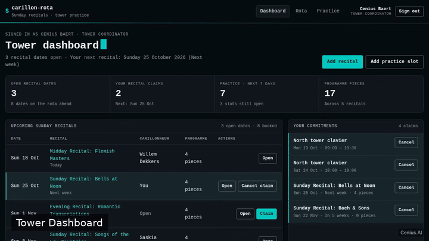
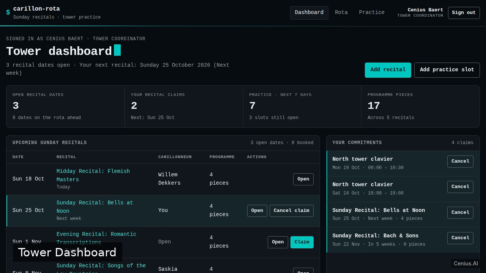
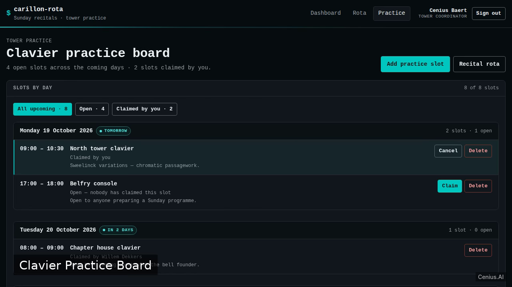

# Carillon Recital Rota — complete Node.js appointment scheduling system example app

Carillon Recital Rota is a clean-minimal full-stack web app for carillonneurs to manage the Sunday recital rota, claim tower clavier practice slots, and maintain recital programmes with arrangement credits. That's **Carillon Recital Rota** — a Apache-2.0-licensed, open-source appointment scheduling system in Node.js you can self-host and modify freely. Fork Carillon Recital Rota, run it, or [remix it on cenius.ai](https://cenius.ai/marketplace/p/carillon-recital-rota?ref=gh&utm_campaign=carillon-recital-rota-nodejs) for a custom Carillon Recital Rota build with full rebrand rights.


[](LICENSE)  [](https://cenius.ai)

[](https://cenius.ai/marketplace/p/carillon-recital-rota?ref=gh&utm_campaign=carillon-recital-rota-nodejs)

> **▶ [Open & edit in cenius.ai](https://cenius.ai/marketplace/p/carillon-recital-rota?ref=gh&utm_campaign=carillon-recital-rota-nodejs)** — one click to an editable workspace: describe changes in plain English, get an instant preview, one-click deploy and host. Modifications made on the platform come with full rebrand & relicense rights.

_Local clone? See [Quick start](#quick-start) below. cenius.ai is the zero-setup path._

## Demo



▶ **[Watch the full demo video](https://cenius.ai/marketplace/p/carillon-recital-rota?ref=gh&utm_campaign=carillon-recital-rota-nodejs)** — the complete walkthrough, playing on the project's cenius.ai page · [MP4 file](.github/media/demo.mp4)

## Screenshots

  

## Architecture

Folder layout: `data/`, `public/`, `tests/`. `install.sh` wires up dependencies and loads seed records; after it runs the app has real data to show. Built in Node.js (35 files). Step-by-step setup guide: [`INSTALL.md`](INSTALL.md).

## Features

- Email/password accounts
- Sunday recital rota with self-booking
- Recital programme pieces with arrangement credits
- Tower clavier practice slots with self-booking
- Dashboard overview
- Seed data and immediate demo readiness

## Quick start

```bash
./install.sh   # installs dependencies + seeds demo data
```

See [`INSTALL.md`](INSTALL.md) for full setup and usage instructions.

## Usage guide

Everything below is reachable from the running app with the demo account
`cenius@cenius.ai` / `cenius`.

### Sign in (`/login`)

The sign-in card shows the demo credential and a **Use demo account** button that
fills and submits the real login form. The email field accepts either the email
address or the username (`cenius`). Use **Create an account** to register with a
display name, email and password (8+ characters).

Wrong credentials always answer with the same message — *"Email or password is
incorrect."* — so the form never reveals whether an address exists. After five
minutes of repeated failures the server throttles further attempts and answers
`429`.

### Dashboard (`/`)

- **KPI strip** — open recital dates, your own claims, practice slots in the next
  seven days, and the total number of programme pieces on the rota.
- **Upcoming Sunday recitals** — every date ahead of today, sorted by Sunday, with
  the assigned carillonneur, the programme length, and **Claim** / **Cancel claim**
  buttons. Your own rows are tinted and marked.
- **Your commitments** — the recitals and practice slots you hold, with inline
  cancellation.
- **Tower practice · next 7 days** — claim or release slots without leaving the page.
- **Quick add** — a compact recital form (Sunday date + title) and practice-slot form
  (date, start, end, tower room). Both write immediately; the new record appears in
  the panels above without a reload.

### Sunday recital rota (`/rota`)

_Full guide: [`USAGE.md`](USAGE.md)_

## FAQ

### Can I deploy Carillon Recital Rota on my own infrastructure?

Clone this repository and run `./install.sh`, then start the app as described in [`INSTALL.md`](INSTALL.md). Carillon Recital Rota is fully self-hostable — no external services are required to try it.

### Does the Carillon Recital Rota license allow commercial use?

Yes — Apache-2.0-licensed, so commercial use, modification, and distribution are all permitted. Read the full terms in [LICENSE](LICENSE).

### How do I make Carillon Recital Rota my own brand?

Yes. You can edit the source directly under the MIT license, or [remix it on cenius.ai](https://cenius.ai/marketplace/p/carillon-recital-rota?ref=gh&utm_campaign=carillon-recital-rota-nodejs) — the platform route grants full rebrand and relicense rights over your derivative.

### What if I want to add features to Carillon Recital Rota without coding?

Non-developers can use [cenius.ai](https://cenius.ai/marketplace/p/carillon-recital-rota?ref=gh&utm_campaign=carillon-recital-rota-nodejs) to make changes. Describe your goal in everyday language and the platform delivers an updated, ready-to-run project — zero coding on your part.

### What powers Carillon Recital Rota under the hood?

Node.js end-to-end. Every file you need to run the app is here in this repository — code, configuration, seed data. Highlights include email/password accounts.

## License & rebranding

Released under the [Apache License 2.0](LICENSE) (© 2026 Cenius AI) — free for personal and commercial use. The Cenius name/logo are trademarks (see NOTICE).

**Need a customized version?** [Remix this app on cenius.ai](https://cenius.ai/marketplace/p/carillon-recital-rota?ref=gh&utm_campaign=carillon-recital-rota-nodejs) — modifications made on the platform come with **full rebrand & relicense rights** over your derivative.

## Built with cenius.ai

This entire application — code, design, seeded demo data — was generated on **[cenius.ai](https://cenius.ai)** from a plain-English description.

- 🚀 [Build your own app on cenius.ai](https://cenius.ai)
- 🎛️ [Remix Carillon Recital Rota on the marketplace](https://cenius.ai/marketplace/p/carillon-recital-rota?ref=gh&utm_campaign=carillon-recital-rota-nodejs) — open it in a workspace, prompt for changes, and ship your own version.

More open-source apps: [the Cenius-ai catalog](https://github.com/Cenius-ai) · [showcase index](https://github.com/Cenius-ai/showcase)
